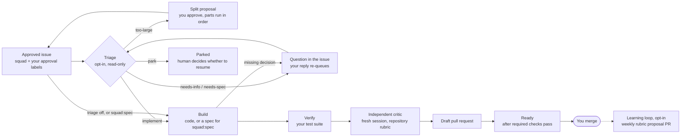
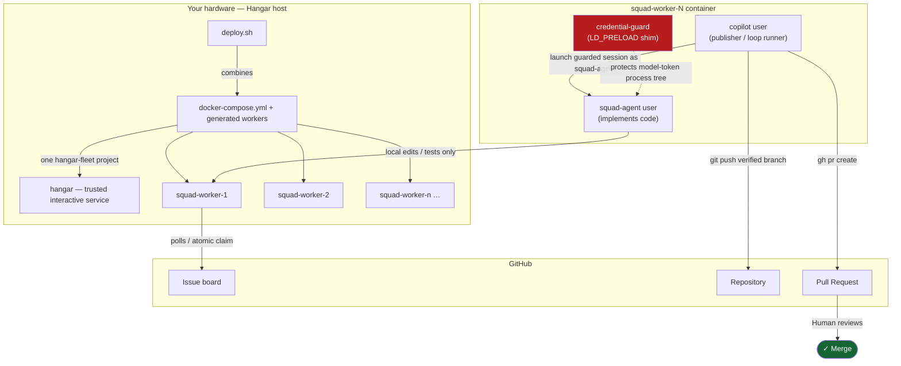

<div align="center">
  
  <h1>Hangar — Software Factory</h1>
  <p><strong>The self-hosted software factory for GitHub Copilot coding agents.</strong></p>
  <p><em>Governed autonomy: approved issues in, reviewed pull requests out.</em></p>
  <p>Your hardware. Your repositories. Your merge button.</p>

  <p>
    
    
    
    
  </p>
</div>

---

> **⚠️ Security notice.** Worker containers run AI-generated code and open real pull requests
> against your repositories. Review the [Security model](#-security-model) section and
> [docs/ARCHITECTURE.md](docs/ARCHITECTURE.md) before connecting any repository you care about.
> Autonomous mode is experimental and disabled by default.

---

## What is Hangar?

Hangar is an open-source, self-hosted **software factory**: it runs a fleet of GitHub Copilot coding agents — called **Squad Workers** — on your own hardware and turns approved GitHub issues into pull requests under rules you control.
The guarded pipeline verifies changes with your own tests, gets an independent critic review, and opens a draft; Ready additionally requires your configured checks to pass on that exact commit.
Opt-in triage can ask questions or propose a split before implementation; spec tasks produce a specification instead of code.
You review and merge; Hangar never touches the merge button.
Self-hosted means the workers and orchestration, not model inference: requests still go to GitHub Copilot.

**Governed autonomy** means agents work unattended within human-defined approval, scope and publication rules.
Unclear work comes back as a question in the issue instead of a guess, and a deterministic publisher — not the model — validates agent artifacts before mutating GitHub.

It is not affiliated with or endorsed by GitHub, Inc. GitHub Copilot is a separate subscription
service with its own [terms](https://docs.github.com/en/site-policy/github-terms/github-terms-for-additional-products-and-features).
Hangar is an independent wrapper and coordination layer that calls the Copilot CLI on your behalf.

---

## 🏭 How the factory works



| Stage | What happens | Details |
| --- | --- | --- |
| **Triage** (opt-in) | A read-only session decides whether the issue can be built as written in one PR: `implement`, `needs-info`, `needs-spec`, `too-large` (with a split proposal) or `park`. It can only hold work back, never approve it. | [Triage](docs/OPERATIONS.md#triage-looptriage-opt-in) |
| **Questions** | When triage or the implementer finds a missing decision, the worker asks in the issue (`squad:needs-*`) instead of guessing. Your reply re-queues the issue and is passed on as a decision. | [Decision stops](docs/OPERATIONS.md#decision-stops-squadneeds-decision) |
| **Split on request** | For a `too-large` issue, `squad:split-approved` turns the stored proposal into ordered child issues; each part runs after the previous one closes. | [Split](docs/OPERATIONS.md#split-on-request-squadsplit-approved) |
| **Spec work type** | `squad:spec` makes the same pipeline write a spec instead of code, path-guarded to `loop.specDir`. Merging the spec approves the implementation. | [Spec](docs/OPERATIONS.md#spec-work-type-squadspec) |
| **Verify and critic** | Your tests run on the exact head; a second, independent session reviews the full diff against a rubric. Code failures get bounded corrections; infrastructure failures block. | [Quality policy](docs/OPERATIONS.md#13-quality-policy-and-recovery) |
| **Draft → Ready** | Every PR starts as a draft and becomes Ready only when the configured `requiredChecks` are green on that exact commit. | [Configuration](#reposjson-fields) |
| **Receipts and metrics** | Every attempt leaves a hidden receipt in the issue; `tools/factory-metrics.py` computes the share of approved issues that reached Ready without intervention, from GitHub alone. | [Metrics](docs/OPERATIONS.md#attempt-receipts-and-reliability-metrics) |
| **Learning loop** (opt-in) | Repeated human corrections become a weekly draft PR that may only change `.loop/review-rubric.md` and `.loop/triage.md`. | [Learning loop](docs/OPERATIONS.md#learning-loop-looplearning-opt-in) |

Triage and learning are opt-in; spec tasks skip triage.
Ready requires enabled verification and critic plus an explicit required-check policy; otherwise a PR stays draft.
The learning loop proposes changes for human review, never applies them automatically; [ADR 0001](docs/adr/0001-factory-direction.md) gates enabling it on the reliability metric staying above 60 %.

### What you do on GitHub

You run the factory with labels and replies; there is no separate UI.

| You | Hangar |
| --- | --- |
| Add `squad` (plus your `requiredLabels`) to an issue | Queues it; the next free worker claims it atomically |
| Reply in an issue labelled `squad:needs-info`, `squad:needs-spec` or `squad:needs-decision` | Re-queues it; your answer reaches triage, implementer and critic as a decision |
| Add `squad:split-approved` to a `squad:too-large` issue | Creates the proposed parts as ordered child issues and closes the parent after the last one |
| Add `scope:large-approved` (`triageOverrideLabel`) and reply | Lets oversized work through triage |
| Add `squad:spec` | Writes a spec instead of code |
| Remove `squad:park` and add `squad` | Builds parked work after all |
| Add `squad:revision` with the requested changes | Revises the existing PR, ahead of new work |
| Merge the PR | Closes the issue (spec PRs only reference it) and releases the next split part |

Status labels you will see: `squad:processing`, `squad:review-pending` (draft waiting for checks),
`squad:done`, `squad:failed`.
Split approval must come from a user in `manualIssueCreators`; replies count from the issue author or those users.
The size override does not grant approval or bypass other gates.

---

## Why Hangar?

Choose Hangar when you want an inspectable, GitHub-issue-driven **software factory** around the Copilot CLI: several workers processing approved work under your own deterministic gates.
Other platforms also support automation and parallel agents; self-hosting alone is not unique to Hangar.

| | Hangar | GitHub Copilot cloud agent | OpenHands | Devin |
| --- | --- | --- | --- | --- |
| Where the agent runs | Your Docker host | GitHub Actions runner (GitHub-hosted by default, self-hosted possible) | Self-hosted or OpenHands Cloud | Cognition's cloud; VPC deployment on Enterprise |
| Source | MIT | Proprietary | Open-source core | Proprietary |
| Model access and billing | Requires a Copilot subscription; plan limits and usage charges apply | Copilot plan and usage policy | Bring a supported LLM provider | Plan allowance; additional usage may cost extra |

What Hangar adds on top of a single agent run:

- **Several workers, one queue** — atomic claims, WIP limits and attempt budgets per repository.
- **Stages with deterministic gates** — triage, decision stops, split, spec, verify and critic;
  the model proposes, a publisher with fixed rules decides what reaches GitHub.
- **An independent critic** — a fresh session, optionally on a different model, with a full-input
  delivery proof; a missing verdict is never treated as approval.
- **Credential isolation** — the agent never holds a repository-authorized token.
- **Measured autonomy** — receipts and a metric for issues that reached Ready without intervention.

Hangar builds on the Copilot CLI and does not replace it.
This is a deployment comparison, not a benchmark or a claim that other products lack governance controls.
Comparison checked on 2026-10-26 against vendor documentation: [Copilot cloud agent][copilot-cloud], [Copilot runners][copilot-runners], [OpenHands][openhands] and [Devin][devin-pricing].
Corrections are welcome.

[copilot-cloud]: https://docs.github.com/en/copilot/concepts/copilot-surfaces/copilot-on-github
[copilot-runners]: https://docs.github.com/en/copilot/how-tos/administer-copilot/manage-for-organization/configure-runner-for-coding-agent
[openhands]: https://github.com/OpenHands/OpenHands
[devin-pricing]: https://devin.ai/pricing

---

## Three pillars

### 🛫 Cockpit

An optional web interface accessible from mobile or desktop — built around **ttyd** and **tmux** —
giving you live visibility into any worker session. `ENABLE_TTYD=true` to activate; off by default.

### ✈️ Squadron

A **fleet of containerised workers**, each mapped to one repository via `repos.json`. Workers
build from source with pinned Copilot/Squad CLI versions and run in separate workspace volumes.
Add an entry to `repos.json` and run `./deploy.sh up`; enable automatic CLI updates only if you
explicitly accept unreviewed upstream upgrades.

### 🧭 Ground Control

The operational layer that keeps quality high and blast radius small:

| Control | What it does |
| --- | --- |
| **Atomic claims** | A Git ref (`squad-claims/issue-N`) is created atomically before the visible `squad:processing` label; only one worker wins |
| **Independent critic** | A second Copilot session — optionally running a different model — reviews the diff *without* the implementer's context |
| **Verify hook** | Runs your own test suite or a custom script before publication; code failures allow bounded correction; infrastructure/policy failures block without code repair |
| **Autonomous budget / draft safety** | `maxPrsPerDay` caps configured unattended attempts, including revisions; WIP1 is optional |
| **Credential isolation** | OS permissions protect publisher credentials; a native guard protects the model-token process tree and strips secrets from child tools |
| **Preflight and retry** | An unhealthy worker claims nothing; eligible transient infrastructure failures get one delayed automatic retry, resuming from a valid checkpoint when available |
| **Fail closed** | Unreadable state, malformed agent output or missing evidence blocks with a reason; it never counts as success |

---

## ✈️ Quick start

### Prerequisites

- Docker Engine 24+ and Docker Compose v2
- `jq` (`brew install jq` / `apt install jq`)
- A GitHub App installed on your organisation or account with **Contents**, **Issues**, and
  **Pull Requests** read/write permissions plus **Actions** read permission
- A user-owned fine-grained PAT with the **Copilot Requests** account permission **only**
  (no repository permissions — the GitHub App owns those)
- An active **GitHub Copilot** subscription on the PAT owner's account
- For the recommended Squad path: a target repository with Squad configuration already committed,
  or Node.js 22.5+ and npm 10+ for the one-time initialization in Step 4

### 1. Clone and copy the example files

> **Source-only release:** Hangar v0.2 has no npm package. Do **not** run unscoped
> `npx hangar`; that package name belongs to an unrelated project.

```bash
git clone https://github.com/timoknapp/Hangar.git
cd Hangar

cp .env.workers.example  .env.workers
cp repos.example.json    repos.json
```

### 2. Configure secrets

Edit `.env.workers` — the four required values:

```dotenv
GH_APP_ID=123456
GH_APP_INSTALL_ID=123456
GH_APP_PEM_FILE=/absolute/path/to/gh-app-private-key.pem
COPILOT_PAT=github_pat_...   # fine-grained, Copilot Requests permission only
```

The App installation ID is the number at the end of its installation URL. See
[the full GitHub App walkthrough](docs/INSTALL.md#2-github-app-setup).

All other settings have safe defaults. Worker `ENABLE_TTYD` and
`INTERACTIVE_ENABLE_TTYD` both default to `false`; worker `SSH_AUTHORIZED_KEY` is optional.

### 3. Assign a repository to a worker

Edit `repos.json` — one entry per worker:

```json
{
  "worker-1": {
    "url":    "https://github.com/your-org/your-repo.git",
    "owner":  "your-org",
    "repo":   "your-repo",
    "branch": "main",
    "model":  "",
    "loop": {
      "autonomous":        false,
      "critic":            true,
      "criticModel":       "",
      "criticRubric":      "repo-aware",
      "verify":            "auto",
      "maxPrsPerDay":      2,
      "implementer":       "squad"
    }
  }
}
```

This is Hangar's **recommended guarded starter profile**, not the raw compatibility defaults:
it enables automatic verification, the independent critic, full Squad implementation, and a
two-PR daily safety cap for autonomous `loop:auto` work. Human-created `squad` issues do not
consume that budget by default (neither do scheduled issues lacking `loop:auto`); set
`unattendedLabels: ["squad"]` to budget all queued work, including revisions. Opt-in
`manualIssueCreators` with explicit `requiredLabels` exempts approved human intake from
that daily budget and WIP1, and prioritizes it on free workers. The [configuration reference](#reposjson-fields) lists the fallback defaults
used when fields are omitted.

### 4. Initialize Squad in the target repository

The recommended `implementer: "squad"` path requires committed Squad configuration in each
target repository. On a machine with Node.js 22.5+ and npm 10+, run:

```bash
cd /path/to/your-target-repository
npx @bradygaster/squad-cli@1.0.0 init --preset default
git status --short
```

Review the generated agents, instructions, workflows, and MCP configuration, then commit and push
them through your normal repository workflow. Unattended workers treat target-repository
configuration as trusted code. See the
[Squad project](https://github.com/bradygaster/squad) for customization options.

### 5. Start Hangar

```bash
./deploy.sh up        # starts interactive Hangar + generated worker services
./deploy.sh status    # confirms the complete hangar-fleet stack
```

Docker now shows one `hangar-fleet` Compose project containing the trusted `hangar` workstation
and every `squad-worker-N` service. Workers poll for open issues carrying the `squad` label. With
the guarded starter profile above, a worker claims, implements, verifies, independently reviews,
and opens a draft PR only after local gates pass.
Ready additionally requires current-head remote checks from an explicit `requiredChecks` policy.
Disabled verification/critic, missing permissions or absent required-check policy never establish Ready.
Incomplete critic delivery reports up to twelve missing ranges and content-mismatch line numbers, never source/result text.
A single redacted or altered line invalidates its whole returned range; inspect those locations before an explicitly authorized recovery, without disabling secret filtering or accepting display/session logs as delivery proof.
See [quality policy and recovery](docs/OPERATIONS.md#13-quality-policy-and-recovery).

> **Loopback-only default.** Interactive SSH/ttyd use ports 2222/7681; worker SSH/ttyd use
> 2231+/7691+. All bind to `127.0.0.1` unless explicitly overridden. Do not expose these ports
> directly to the internet; use a VPN or authenticated reverse proxy.

## 🖥️ Interactive workstation (optional)

The `hangar` service is an operator-driven development container rather than an autonomous
worker. It provides SSH/ttyd, tmux, Copilot CLI, Squad CLI, and persistent workspace/auth volumes.
It starts with the workers under the same Compose project; configure its `INTERACTIVE_*` values
in `.env.workers`, then run the one-time authentication helper if needed:

```bash
./deploy.sh restart-interactive
docker exec -it hangar su - copilot -c 'bash ~/auth-setup.sh'
```

This interactive image intentionally gives the `copilot` operator passwordless sudo and does not
use the worker publisher/implementer boundary. Treat it as a trusted workstation, keep its ports
on loopback, and do not use it as a sandbox for untrusted repositories.

---

## 🗺️ Architecture



The step-by-step flight pipeline, the master cycle and every operational scenario (verification
failure, critic requests changes, revisions, budget exhaustion, …) are diagrammed in
[docs/OPERATIONS.md → Pipeline scenarios](docs/OPERATIONS.md#14-pipeline-scenarios).

---

## Configuration reference

### `repos.json` fields

| Field | Default | Description |
| --- | --- | --- |
| `url` | — | HTTPS clone URL |
| `owner` / `repo` | — | Used for `gh` API calls |
| `branch` | `main` | Base branch |
| `model` | CLI default | Copilot model for implementation |
| `loop.autonomous` | `false` | Self-generate work when the board is empty (**experimental**) |
| `loop.critic` | `false` | Run an independent second-pass critic review |
| `loop.criticModel` | same as `model` | Separate model for the critic pass |
| `loop.verify` | `"off"` | `"off"` \| `"auto"` \| `"<cmd>"` \| `".loop/verify.sh"` |
| `loop.maxRetries` | `2` | Total correction allowance shared by verification and critic |
| `loop.maxRetriesManual` | `4` | Same allowance for publisher-verified manual issues (`manualIssueCreators` + approval provenance) |
| `loop.maxPrsPerDay` | `0` (off) | Repository-wide daily cap for configured unattended attempts, including revisions |
| `loop.maxOpenAutoIssues` | `3` | Concurrent self-generated issue cap |
| `loop.goalFile` | `"auto"` | Goal source for autonomous planning; discovers `.loop/GOAL.md`, `BACKLOG.md`, or `.squad/GOAL.md` |
| `loop.workScope` | `"all"` | `"all"` \| `"green-fit"` (only deterministic, well-scoped autonomous tasks) |
| `loop.criticRubric` | `"auto"` | `"auto"` \| `"repo-aware"` \| repository-relative rubric path |
| `loop.implementer` | `"plain"` | `"plain"` (restricted) \| `"squad"` (full Squad coordinator; recommended path) |
| `loop.requiredLabels` | `[]` | Additional approval labels checked at admission, publication and Ready |
| `loop.manualIssueCreators` | `[]` | Human creator login allowlist for priority intake outside WIP/daily caps; requires nonempty explicit `requiredLabels` |
| `loop.unattendedLabels` | `["loop:auto"]` | Work labels subject to the attempt budget, including revisions |
| `loop.requiredChecks` | `[]` | Exact required successful check names; empty means draft-only |
| `loop.checkBackend` | `"checks"` | `"actions"` uses exact-head workflow/job APIs if check-rollup access is unavailable |
| `loop.requiredWorkflows` | `[]` | Exact universal workflow names required by the Actions backend |

| `loop.maxActiveIssues` | `0` | `1` enables repository-wide WIP through close/merge; explicitly approved allowlisted manual intake is exempt |
| `loop.maxTaskSeconds` | `3600` | Total implementation, verification and correction deadline; pending checks keep at least `LOOP_CHECK_WAIT_SECONDS` (3600) |
| `loop.maxReviewBytes` | `262144` | Maximum complete review input bytes; oversize blocks |
| `loop.profileDir` | `""` | Root-owned read-only operator profile, never repository-selected |
| `loop.triage` | `false` | Read-only triage before implementation; holds unclear, unspecified, oversized or not-worth-it work (`loop:auto` issues are always triaged) |
| `loop.triageMaxFiles` | `25` | Primary files above which triage holds work as `squad:too-large` |
| `loop.triageMaxLines` | `1500` | Changed lines above which triage holds work as `squad:too-large` |
| `loop.triageOverrideLabel` | `"scope:large-approved"` | Human label that lets oversized work through triage |
| `loop.specDir` | `"specs/issue-{n}"` | Directory a `squad:spec` task may change; `{n}` is the issue number |
| `loop.learning` | `false` | Weekly draft PR that may only change `.loop/review-rubric.md` and `.loop/triage.md`, from repeated human corrections |


### Interactive settings in `.env.workers`

| Setting | Default | Description |
| --- | --- | --- |
| `INTERACTIVE_REPO_URL` | empty | Optional repository cloned into the trusted workstation |
| `INTERACTIVE_WORKSPACE_NAME` | `repo` | Workspace directory below `/workspace` |
| `INTERACTIVE_ENABLE_TTYD` | `false` | Enable the writable browser terminal |
| `INTERACTIVE_TTYD_BIND_ADDRESS` | `127.0.0.1` | Bind address for the browser terminal |
| `INTERACTIVE_SSH_BIND_ADDRESS` | `127.0.0.1` | Bind address for interactive SSH; set to a trusted LAN IP only when direct access is required |
| `INTERACTIVE_PREVIEW_BIND_ADDRESS` | `127.0.0.1` | Bind address for the preview server |
| `INTERACTIVE_TTYD_PORT` | `7681` | Interactive browser-terminal port |
| `INTERACTIVE_SSH_PORT` | `2222` | Interactive SSH port |
| `INTERACTIVE_VOLUME_PREFIX` | `hangar` | Stable volume prefix; keep unchanged when upgrading existing data |

### `deploy.sh` commands

```text
./deploy.sh up                  Start interactive Hangar and all workers
./deploy.sh down                Stop the complete Hangar platform
./deploy.sh restart [N]         Restart worker N
./deploy.sh restart-interactive Rebuild/restart only the interactive service
./deploy.sh reset [N]           Wipe workspace volume and restart worker N
./deploy.sh generate            Regenerate compose file only (no docker action)
./deploy.sh status              Show all services in the unified stack
./deploy.sh set-model <model>   Update Copilot model for all workers
```

---

## 🔒 Security model

Hangar uses separate OS identities and layered process controls for the trusted publisher and the
component that runs Copilot-generated code:

| User | Automated pipeline role | Security boundary |
| --- | --- | --- |
| `copilot` (publisher) | Own GitHub App credentials, sanitize Git config, orchestrate gates, push branches, create PRs | Trusted operator identity; automated build/test commands are delegated rather than run with publisher credentials |
| `squad-agent` (implementer) | Write code, run local shell/tests in `/workspace`, read external docs and configured repository MCP tools | Cannot traverse publisher home, use publisher sudo, or receive a repository-authorized token |

Additional mitigations:

- **`credential-guard`** binary + LD_PRELOAD constructor — the model PAT is delivered through
  an anonymous pipe, token-bearing processes are marked non-dumpable after every exec, and shell,
  delegated agents, and MCP processes cannot read those environments through `/proc`.
- **Publication barrier** — full Squad sessions explicitly deny `git push`/`git send-pack`, disable
  the built-in GitHub MCP, strip named auth variables from shell/MCP environments, and receive no
  repository-authorized credential. External web reads and explicitly configured repository MCP
  servers remain available and can transmit repository data; review them as trusted code.
- **Loopback-only management ports** — ttyd and SSH do not bind to `0.0.0.0` by default.
- **Human-gated merges** — workers open PRs; only a human can merge.

See [docs/ARCHITECTURE.md](docs/ARCHITECTURE.md) for the full trust boundary diagram and
threat model.

---

## Current limitations (v0.2)

- **Source-only** — no prebuilt Docker image, no published npm package, no CLI installer.
  Build from source with `./deploy.sh up`.
- One repository per worker container. Multi-repo workers are not yet supported.
- The Cockpit dashboard is functional but minimal.
- Autonomous mode (`loop.autonomous: true`) is experimental. Enable only with a low
  `maxPrsPerDay` and review every PR manually until you trust the output quality. The cap applies
  to `unattendedLabels` (default `loop:auto`); configure it consistently for all producers.
- Requires an active GitHub Copilot subscription. Copilot models are not self-hosted; all
  inference happens via GitHub's Copilot API.

---

## Documentation

| Document | Contents |
| --- | --- |
| [docs/INSTALL.md](docs/INSTALL.md) | Full installation guide — prerequisites, GitHub App setup, first worker |
| [docs/ARCHITECTURE.md](docs/ARCHITECTURE.md) | System design, trust boundaries, threat model, component map |
| [docs/OPERATIONS.md](docs/OPERATIONS.md) | Day-to-day ops: factory stages, logs, scaling, credential rotation, debugging, pipeline scenarios |
| [docs/adr/0001-factory-direction.md](docs/adr/0001-factory-direction.md) | Why the factory is staged this way and how its success is measured |

---

## Contributing

Issues and pull requests are welcome. Please open an issue to discuss non-trivial changes before
submitting a PR. All contributions must pass the test suite in `tests/`.

---

## License

MIT — see [LICENSE](LICENSE).

---

<div align="center">
  <sub>
    Hangar is an independent open-source project and is not affiliated with or endorsed by GitHub, Inc.<br/>
    GitHub® and GitHub Copilot® are registered trademarks of GitHub, Inc.<br/>
    A valid GitHub Copilot subscription and acceptance of
    <a href="https://docs.github.com/en/site-policy/github-terms/github-terms-for-additional-products-and-features">GitHub's terms</a>
    are required to use this software.
  </sub>
</div>
