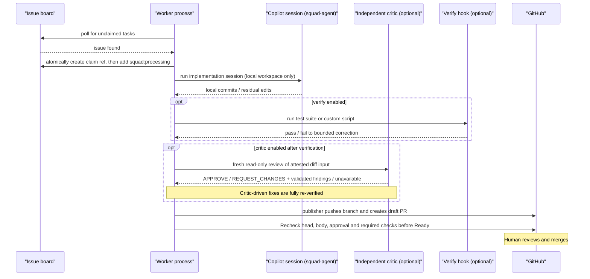
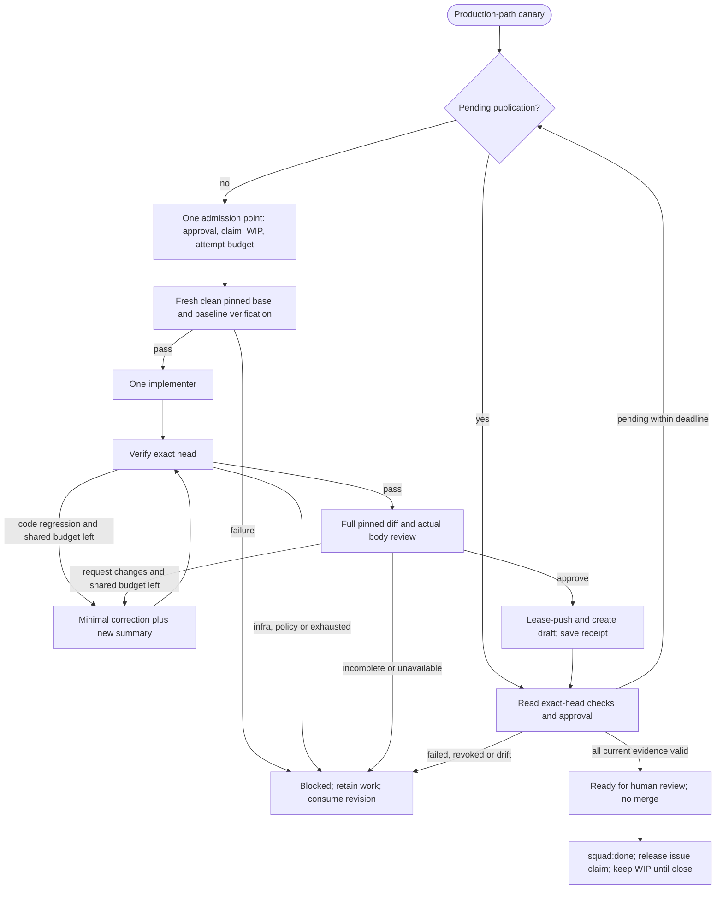
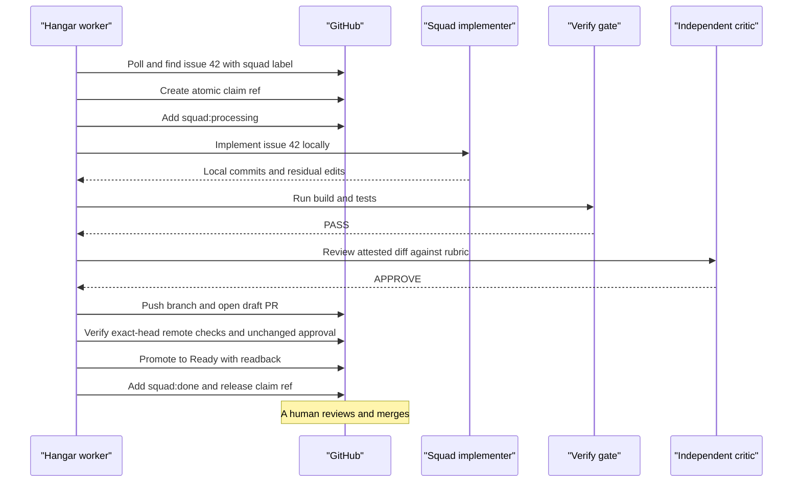
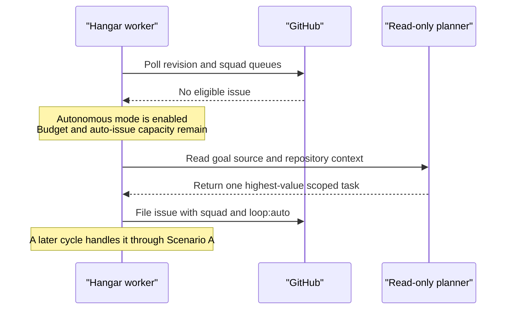
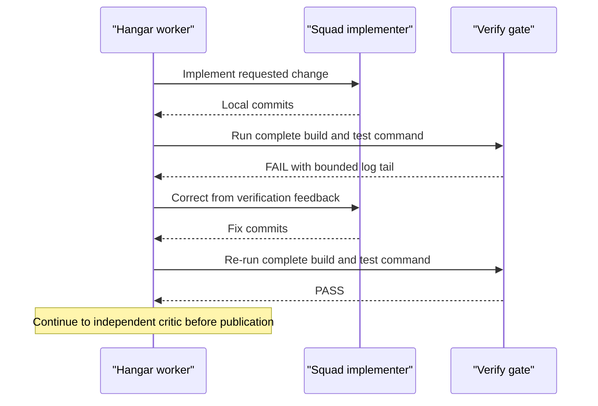
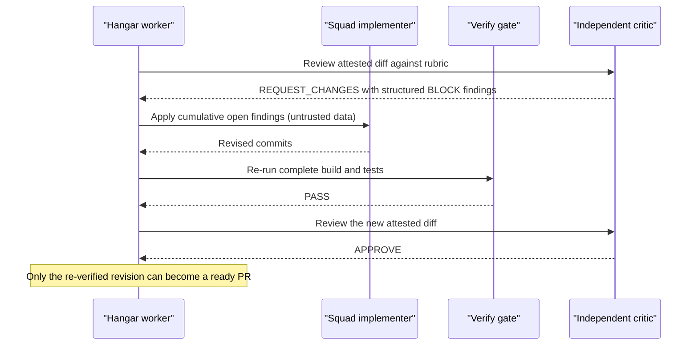
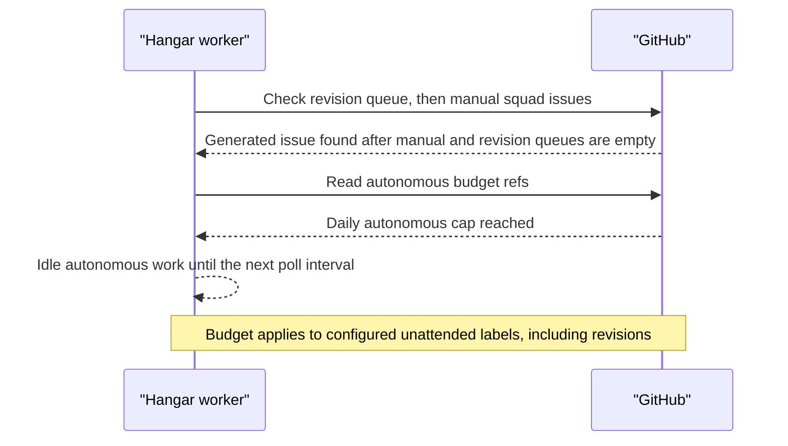

# Hangar — Operations Guide

> Return to [README](../README.md)

---

## Table of contents

1. [Daily workflow](#1-daily-workflow)
2. [Platform management](#2-platform-management)
3. [Viewing logs](#3-viewing-logs)
4. [Cockpit web terminal](#4-cockpit-web-terminal)
5. [Worker health and preflight](#5-worker-health-and-preflight)
6. [Credential rotation](#6-credential-rotation)
7. [Scaling the fleet](#7-scaling-the-fleet)
8. [Workspace lifecycle](#8-workspace-lifecycle)
9. [Updating the CLI](#9-updating-the-cli)
10. [Rebuilding worker images](#10-rebuilding-worker-images)
11. [Debugging worker sessions](#11-debugging-worker-sessions)
12. [Monitoring and alerting](#12-monitoring-and-alerting)
13. [Quality policy and recovery](#13-quality-policy-and-recovery)
14. [Pipeline scenarios](#14-pipeline-scenarios)

---

## 1. Daily workflow

The normal operating pattern once Hangar is running:

1. **Open an issue** on the repository assigned to a worker.
2. **Apply the `squad` label** and any configured required approval labels to put it on the worker queue.
3. **Wait** — the worker claims the issue within one `POLL_INTERVAL` (default: 60 seconds).
4. **Watch progress** via `docker logs -f squad-worker-1` or the Cockpit terminal.
5. **Review the PR** when it appears — treat it like any externally submitted patch.
6. **Merge** if satisfied. For another implementation pass, add the requested details to the issue
  and apply `squad:revision`; revision work is prioritized over new queue items.

---

## 2. Platform management

### Start / stop

```bash
./deploy.sh up       # start interactive Hangar and all workers
./deploy.sh down     # stop/remove the complete stack (volumes preserved)
```

### Restart a specific worker

```bash
./deploy.sh restart 1    # restart worker-1
./deploy.sh restart 3    # restart worker-3
```

### Restart the trusted interactive service

```bash
./deploy.sh restart-interactive
```

### Reset a worker (wipe workspace)

```bash
./deploy.sh reset 1      # delete workspace volume and restart worker-1
```

Use this if the workspace git state is corrupted or if you want the worker to re-clone from
scratch. This does **not** delete the `copilot-data` or `sshd` volumes.

### Show the platform

```bash
./deploy.sh status
# or
docker compose -p hangar-fleet \
  -f docker-compose.yml \
  -f docker-compose.workers.yml \
  --env-file .env.workers ps
```

### Change the Copilot model for all workers

Pass a model ID available to your Copilot plan to `./deploy.sh set-model`. This updates the model
in `repos.json`, regenerates the compose file, and recreates only worker services; the interactive
workstation stays running. Leave `model` empty to use the Copilot CLI default rather than pinning
an ID that may become stale.

---

## 3. Viewing logs

```bash
# Follow logs for a specific worker
docker logs -f squad-worker-1

# Last 100 lines
docker logs --tail=100 squad-worker-1

# Complete platform
docker compose -p hangar-fleet \
  -f docker-compose.yml \
  -f docker-compose.workers.yml \
  --env-file .env.workers logs -f
```

### Log markers

| Prefix | Meaning |
| --- | --- |
| `>>> [worker-N]` | Container entrypoint messages |
| `[<UTC timestamp>] [worker-N]` | Worker-loop lifecycle, claims, gates, and publication |
| `[<UTC timestamp>] [worker-N] [copilot]` | Streamed implementation-session output |
| `ERROR:` inside a worker line | A failed operation or fail-closed safety decision |

---

## 4. Cockpit web terminal

The unified stack has two intentionally different terminal types:

- `hangar`: trusted operator workstation, SSH 2222 and optional ttyd 7681
- `squad-worker-N`: guarded autonomous publisher/implementer runtime, SSH 2231+ and ttyd 7691+

Enable either terminal type in `.env.workers`:

```dotenv
INTERACTIVE_ENABLE_TTYD=true
ENABLE_TTYD=true
```

Then restart the corresponding service:

```bash
./deploy.sh restart-interactive
./deploy.sh restart 1
```

Access trusted interactive Hangar at `http://127.0.0.1:7681`; worker-1 is at
`http://127.0.0.1:7691`, worker-2 at `7692`, etc.

The Cockpit opens a live, **writable** tmux session as the trusted `copilot` publisher user. You can:

- Watch the worker loop in real time
- Inspect `/workspace/<repo>` for uncommitted changes
- Run `gh pr list` to see recent PR activity

> **Security reminder.** The Cockpit does not require authentication by default and its shell can
> publish to GitHub. Keep it disabled unless needed. Never expose it directly; use a VPN or an
> authenticated reverse proxy and retain the default loopback bind.

### SSH access

The trusted interactive service uses the SSH identity persisted by `auth-setup.sh`. Workers use
`SSH_AUTHORIZED_KEY` from `.env.workers`:

```bash
ssh -p 2222 copilot@127.0.0.1    # trusted interactive Hangar
ssh -p 2231 copilot@127.0.0.1    # worker-1
ssh -p 2232 copilot@127.0.0.1    # worker-2
```

---

## 5. Worker health and preflight

The image includes `runtime-preflight.sh`, an explicit live Copilot API probe for checking the
credential and configured/default model. It is not invoked automatically on every restart.

### Manual preflight

```bash
docker exec squad-worker-1 /home/copilot/runtime-preflight.sh
```

A passing preflight prints: `Copilot runtime preflight: PASS (<model or default model>)`

A failing preflight usually means:

- `COPILOT_PAT` is expired or invalid
- The PAT owner's Copilot subscription has lapsed
- The specified model is not available on the account's subscription tier

### Check active claims

```bash
gh issue list --repo <owner>/<repo> --label "squad:processing" --state open
gh api repos/<owner>/<repo>/git/matching-refs/heads/squad-claims/
```

---

## 6. Credential rotation

### Rotating the Copilot PAT

1. Generate a new fine-grained PAT (Copilot Requests account permission only) from GitHub Settings.
2. Update `COPILOT_PAT` in `.env.workers`.
3. Run `./deploy.sh up`; Compose recreates affected workers without restarting interactive Hangar.

Workers do not cache the PAT between restarts; the new value takes effect immediately on the
next container start.

### Rotating the GitHub App private key

1. In your GitHub App settings, generate a new private key.
2. Replace the `.pem` file at the path specified in `GH_APP_PEM_FILE`.
3. Run `./deploy.sh up` to recreate affected workers.
4. Revoke the old private key from the GitHub App settings.

> The short-lived App installation token (generated from the PEM) is refreshed roughly every
> 45 minutes by `generate-token.sh`. A key rotation takes effect on the next token refresh
> after the container restart.

---

## 7. Scaling the fleet

### Adding a worker

1. Add a new entry to `repos.json`:

   ```json
   "worker-3": {
     "url":   "https://github.com/your-org/another-repo.git",
     "owner": "your-org",
     "repo":  "another-repo",
     "branch": "main",
    "model": "",
     "loop": {
       "autonomous": false,
       "critic": true,
       "verify": "auto",
       "maxPrsPerDay": 2,
       "workScope": "green-fit",
       "criticRubric": "repo-aware",
       "implementer": "squad"
     }
   }
   ```

2. Run `./deploy.sh up` — only the new container is created; existing workers are unaffected.

### Removing a worker

1. Stop the specific container: `docker stop squad-worker-3 && docker rm squad-worker-3`
2. Remove the entry from `repos.json`.
3. Optionally remove the volumes:

   ```bash
   docker volume rm \
     hangar-fleet_squad-worker-3-workspace \
     hangar-fleet_squad-worker-3-copilot-data \
     hangar-fleet_squad-worker-3-sshd
   ```

4. Regenerate the compose file: `./deploy.sh generate`

### Multiple workers on the same repository

You can point multiple workers at the same repository. Workers coordinate through atomic Git
refs (`squad-claims/issue-N`) and use labels only as visible workflow state. Repository-wide
`squad-budget/<date>/slot-N` refs coordinate the daily autonomous `loop:auto` budget. Manual
`squad` issues and all revisions bypass that budget and are prioritized over generated work.
This is useful for parallelising work on a large backlog but requires careful rate-limit
awareness (GitHub API quota is shared per installation).

---

## 8. Workspace lifecycle

Each worker's repository checkout lives in a Compose-managed volume mounted at
`/workspace/<repo>`. With the default project name, Docker normally renders it as
`hangar-fleet_squad-worker-N-workspace`; confirm the exact name with `docker volume ls`.

### Inspect the workspace

```bash
docker exec -it squad-worker-1 bash
ls /workspace/
git -C /workspace/<repo> log --oneline -5
```

**Evidence failures are not a reset instruction.** Before using either reset recipe below,
read [When Git accepts the repository but Hangar blocks evidence](#when-git-accepts-the-repository-but-hangar-blocks-evidence).
For the known C1 history restriction, preserve the checkout; resetting or re-cloning is not a remedy.

### Hard reset (without destroying the volume)

```bash
docker exec squad-worker-1 bash -c \
  "git -C /workspace/<repo> reset --hard origin/main && git clean -fd"
```

### Full volume wipe and re-clone

```bash
./deploy.sh reset 1
```

---

## 9. Updating the CLI

Workers use the Copilot and Squad CLI versions pinned in `worker/Dockerfile` by default.
This keeps policy flags and custom-agent behavior reproducible.

To opt into unreviewed upstream updates on each container start:

```bash
AUTO_UPDATE_CLI=true     # in .env.workers
./deploy.sh restart 1
```

For a reviewed upgrade, leave `AUTO_UPDATE_CLI=false`, update the two version arguments in
`worker/Dockerfile`, rebuild, and rerun the complete local/live validation suite before rollout.

```bash
AUTO_UPDATE_CLI=false
./deploy.sh up
```

---

## 10. Rebuilding worker images

The worker image is built on `./deploy.sh up` if it doesn't exist. To force a rebuild:

```bash
# Regenerate workers, then rebuild only worker services without cache
./deploy.sh generate
docker compose -p hangar-fleet \
  -f docker-compose.yml \
  -f docker-compose.workers.yml \
  --env-file .env.workers \
  build --no-cache $(jq -r 'keys[] | "squad-\(.)"' repos.json)

# Recreate only services whose image changed
./deploy.sh up
```

Set `CACHE_BUST` explicitly only when you need to invalidate the CLI install layer; normal
`./deploy.sh up` builds reuse Docker's cache and the pinned versions.

---

## 11. Debugging worker sessions

### Attaching to a running worker

```bash
docker exec -it squad-worker-1 bash
# You are now the copilot user inside the container
```

### Inspecting a failed implementation session

After a failed attempt, the workspace branch remains checked out with any partial changes:

```bash
docker exec -it squad-worker-1 bash
git -C /workspace/<repo> log --oneline -3
git -C /workspace/<repo> diff HEAD
```

### Running a manual implementation session

Do not invoke `copilot` directly as `squad-agent`: that bypasses Hangar's anonymous-pipe token
delivery, process guard, secret-child policy, and cleanup checks. Use the shipped runtime preflight
for an auth/model probe, or create a disposable labelled issue to exercise the complete path.

### Critic session debugging

Enable the critic with detailed logging by temporarily setting `LOOP_CRITIC_RUBRIC=repo-aware`
and watching the worker log for `[CRITIC]` lines.

---

## 12. Monitoring and alerting

Hangar does not ship a monitoring stack. Recommended approaches:

### Log forwarding

Use Docker's daemon-level log-driver configuration (`json-file`, `local`, `syslog`, `fluentd`)
to forward or rotate logs consistently across the complete stack. Do not hand-edit
`docker-compose.workers.yml`; it is regenerated by `deploy.sh`. For per-service logging policy,
change the worker template in `deploy.sh` and the interactive service in `docker-compose.yml`,
then add a generated-Compose regression test.

```json
{
  "log-driver": "local",
  "log-opts": {
    "max-size": "50m",
    "max-file": "5"
  }
}
```

### Health check

Each worker container exposes no HTTP health endpoint by default. A simple Docker health check
can be added to the worker template in `deploy.sh` to verify the polling loop is alive:

```yaml
healthcheck:
  test: ["CMD", "pgrep", "-f", "worker-loop.sh"]
  interval: 60s
  timeout: 5s
  retries: 3
```

### PR rate monitoring

Check the daily PR volume with:

```bash
gh pr list --repo your-org/your-repo \
  --search "is:pr created:>$(date -d '24 hours ago' '+%Y-%m-%dT%H:%M:%SZ') author:app/<your-app-slug>" \
  --json number,title | jq length
```

### Attempt receipts and reliability metrics

Every attempt ends with an issue comment carrying one hidden marker, for example:

```text
<!-- hangar-receipt {"v":1,"worker":"worker-1","kind":"issue","stage":"review","outcome":"failed","class":"infrastructure","seconds":1840,"implementerCredits":714} -->
```

- `outcome`: `ready`, `draft` (task-mandated), `ci-revision`, `failed` or `no-change` (the implementer stopped and asks for a decision).
- `class`: `infrastructure`, `policy`, `code`, `review`, `decision` or `unclassified` for an unknown block reason.
- `stage`: the last stage reached (`admission`, `implement`, `verify`, `review`, `publish`).
- `seconds` and `implementerCredits` (implementer plus correction sessions) are `"unknown"` when not observed; they are never reported as zero.

All values are publisher-derived; agent text never enters the marker.
Compute the main metric (approved issues that reached Ready without manual intervention) from GitHub alone:

```bash
python3 tools/factory-metrics.py your-org/your-repo --since 2026-01-01
```

`--since` filters worker activity (receipts and label changes) by date, not issue creation: an older issue attempted after a rollout counts with its later attempts only.
Issues from before receipts existed are counted from label history and reported as legacy.
See [ADR 0001](adr/0001-factory-direction.md) for how the metric gates later changes.

### Worker preflight and automatic retry

Before every claim a worker checks its own health and claims nothing while unhealthy:

- free disk space in the workspace (`LOOP_MIN_FREE_MB`, default 2048),
- clean workspace, safe Git metadata, repairable shared directory modes and a working `git fetch` of the default branch,
- the installed Copilot CLI equals the version pinned at image build (`/etc/hangar-copilot-cli-version`, from the `COPILOT_CLI_VERSION` build argument; images without the file skip this check), unless `AUTO_UPDATE_CLI=true`,
- implementer and critic models answer a minimal read-only probe (cached for `LOOP_MODEL_PROBE_TTL` seconds, default 3600),
- Playwright browsers match every `node_modules/playwright-core` version in tracked `package-lock.json` files at the fetched base; a missing version is installed once as the coding user (`npm exec playwright-core install chromium`, no credentials) and remembered in the browser cache; a failed install blocks claiming.

An unhealthy worker logs each distinct reason once and leaves the issue untouched for other workers.

A transient infrastructure failure (base preparation or fetch, CLI crash or timeout, unusable verification launcher, critic process failure, PR/check API failure, interruption) gets exactly one automatic retry per issue.
The blocked comment says so and carries `<!-- hangar-auto-retry -->`; that marker in GitHub is the durable once-per-issue guard, and unreadable comment history means no retry.
After `LOOP_RETRY_DELAY_SECONDS` (default 600) a worker removes `squad:failed`; work with an already pushed branch continues as `squad:revision`.
Closing the issue, removing `squad` or retrying it by hand cancels the pending automatic retry.
Deterministic failures (delivery proof for oversized or masked review input, drift, policy, scope, code, review, decision stops) never retry automatically.

### Decision stops (`squad:needs-decision`)

When the implementer deliberately stops without changes (a missing decision, a contradiction in the issue), that is a question, not a failure.
The worker posts the implementer's redacted handoff, sets `squad:needs-decision`, and removes `squad` and `squad:processing` so external queue dispatchers can move on; approval labels are never touched.
A reply in the issue from the issue author or a manual creator (`manualIssueCreators`, case-insensitive) re-queues it: the next free worker removes `squad:needs-decision` and adds `squad` again.
Bot comments and replies to an older decision request never re-queue; unreadable comment history means no re-queue.
On the next attempt those answers are given to the implementer and the independent review as decisions.
The receipt records `no-change` / `decision`; it counts as a question per issue, not as an intervention.
A crashed or timed-out implementer is still `squad:failed`. To stop waiting, close the issue or remove `squad:needs-decision`.

### Triage (`loop.triage`, opt-in)

With `loop.triage: true`, a read-only model session runs after the claim and the clean baseline, before any implementation.
It cannot approve or claim anything; it only decides whether approved work can be implemented as written in one pull request:

| Outcome | Label | Next step |
| --- | --- | --- |
| `implement` | — | Implementation starts in the same attempt |
| `needs-info` | `squad:needs-info` | Answer the questions in the issue (author or approver) |
| `needs-spec` | `squad:needs-spec` | Agree the behaviour in the issue, then reply |
| `too-large` | `squad:too-large` | Create the proposed parts, or add `triageOverrideLabel` and reply |
| `park` | `squad:park` | Remove `squad:park` and add `squad` to do it after all |

The publisher validates the output strictly (one `TRIAGE_JSON` block, fixed fields, at most 5 questions); anything else blocks as `infrastructure`, never as `implement`.
Size limits (`triageMaxFiles`, `triageMaxLines`) are enforced by the publisher from the estimate, not left to the model; `triageOverrideLabel` lets oversized work through.
Holds remove `squad` and `squad:processing`, keep approval labels and release the claim; answers re-queue exactly like decision stops, and the next triage sees them.
`loop:auto` issues are always triaged with strict eligibility (bounded bug or chore, known root cause, localized, small, no auth/data/security impact); when in doubt they are parked.
Revisions and checkpoint resumes skip triage.
An optional `.loop/triage.md`, read from the pinned base like the review rubric, adds repository notes (size conventions, spec rules); working-tree edits are ignored.

### Split on request (`squad:split-approved`)

When triage holds an issue as `squad:too-large`, its comment carries the validated split proposal.
Adding `squad:split-approved` (by a user in `manualIssueCreators`; the latest label event counts, bots and other users are ignored) lets the next free worker create one child issue per part from that stored proposal, without a new model call.
Each child links its parent, carries the part's acceptance criteria and exactly the parent's `requiredLabels`: the split approval is the approval for these parts. `scope:large-approved` and status labels are never copied.
Parts run in order: only one child carries `squad`; the next is released when the previous closes as completed.
The parent changes to `squad:split` with a list of its parts and is closed after the last part.
A part closed as not planned stops the chain (`squad:split-stopped`, one comment on the parent); reopen it or add `squad` to a later part to continue.
Creation is recorded on the parent per part, so an interrupted split resumes without duplicates.
Parts are manual intake like their parent: they bypass unattended WIP (`maxActiveIssues`) and the daily attempt budget.
This applies only while the part carries this publisher's part marker, the parent records it, and the parent is open, created by a user in `manualIssueCreators` and still has every `requiredLabels` label set by such a user; otherwise the part falls back to the unattended rules.
Repository-specific queues (backlog files, dispatchers) are not edited.
Before each model phase, publisher metadata includes `splitApproval` for a verified manual split child: the parent number, part index/total, human creator and current required-label approval events.
The child's bot creator and copied bot-applied labels remain visible; inherited approval is explicit rather than inferred from those bot events.
Missing or revoked parent approval blocks the run and clears the prior evidence snapshot; this does not widen the child scope or relax review gates.

### Spec work type (`squad:spec`)

An approved issue that also carries `squad:spec` runs the normal pipeline with a spec assignment instead of code.
It skips triage. The implementer writes or updates the spec under `loop.specDir` (default `specs/issue-{n}`, for example `openspec/changes/issue-{n}` for repositories that use OpenSpec), following the repository's conventions or, without them, product (behaviour, testable acceptance criteria, non-goals, open questions) and technical (approach, affected areas, validation, risks) sections.
A deterministic path guard runs before review: any changed path outside that directory, including renames out of it, blocks as `policy` without automatic retry.
The independent review adds a spec rubric (testable acceptance, consistency, open questions stay open, no invented decisions).
The pull request is titled `spec: #n …` and references the issue without closing it: merging the spec is the approval for implementation.
Later implementation runs for the same issue read the merged spec from the pinned base; unmerged spec branches and working-tree edits are ignored.
When triage holds an issue as `squad:needs-spec`, adding `squad:spec` re-queues it as a spec task.

### Learning loop (`loop.learning`, opt-in)

[ADR 0001](adr/0001-factory-direction.md) enables this only after the main metric stays above 60 %; the operator decides.
With `loop.learning: true`, an idle worker looks at the last 7 days of this repository once a week and collects human corrections of the factory's own work:
- human commits on an agent PR before merge;
- agent PRs closed without merge;
- human replies on an agent PR after the worker's last comment;
- human triage overrides (`scope:large-approved`, `squad:spec`).

Bots, older items, other branches and earlier learning PRs are ignored.
Only a kind seen on at least two different PRs or issues counts; one-off signals produce nothing.
For repeated signals, a read-only session proposes the full new content of `.loop/review-rubric.md` and/or `.loop/triage.md` as validated JSON; the publisher writes only those files, a path guard checks the commit before push, and the result is a draft pull request (`squad/learning-<date>`, at most one open at a time) for a human to merge.
It never edits code, the operator profile or the core rubric.

### Checkpoint resume and reaper

After the implementer produced committed work, the worker writes a private checkpoint (branch, exact HEAD, pinned base, issue contract, summary).
When an automatic retry later picks the issue up on the same worker, it resumes from that commit: it proves the pinned base again and reruns exactly the normal gates and publisher, never the implementer.
A changed issue contract, another worker, a moved or deleted branch, a dirty workspace or a malformed checkpoint starts a fresh attempt instead; nothing is discarded.
A checkpoint is dropped once its work is pushed, or when the issue is closed or loses `squad`.

On an idle worker, at most every `LOOP_REAP_INTERVAL` seconds (default 3600), the reaper looks for atomic claims whose claim commit names this worker.
Because the worker holds no work, such a claim is an orphan of a crash: it is blocked as an interrupted attempt, which makes it eligible for the automatic retry.
Claims of other workers are never touched, and the reaper never deletes branches or work.

### Split critic review for large changes

When a change exceeds `LOOP_CRITIC_SPLIT_LINES` diff lines (default 2000), the independent review runs as several parts.
Changed files are grouped whole and in order; binary files only add a short blob-ID entry.
Each part is a fresh critic session with its own nonce and its own complete-delivery proof, and every part must approve.
A rejecting part stops the review, names its part number, and keeps its findings in the shared ledger for the correction session.
A single part that alone exceeds `LOOP_MAX_REVIEW_BYTES` still blocks without a model call.
Publication binds the ordered list of approved part hashes.

### Review input the CLI masks

The Copilot CLI hides secret-looking text (for example `Authorization: Bearer <value>` fixtures) from every model, so the critic cannot be shown those lines.
After the reversible escaping has done what it can, any remaining masked line no longer fails the attempt.
All other gates must still pass; the change is published as a draft whose body names the unreviewed review-input line numbers, the issue gets `squad:needs-decision`, and the worker comment asks a human to review exactly those lines.
Such a draft is never promoted to Ready automatically.
Line numbers are reported, never the masked text.

---

> Back to [README](../README.md) · [Install](INSTALL.md) · [Architecture](ARCHITECTURE.md)

## 13. Quality policy and recovery

### Operator-owned repository policy

Configure identical gate/admission fields for every worker sharing a repository.
`requiredLabels` is an array of extra approval labels; its default is empty for generic compatibility.
Labels are necessary controls, not proof of who approved or permission to expand a design-only issue into product implementation.
Removing approval, closing the issue, changing its title/body or replacing/deleting a claim cancels publication/readiness.
`unattendedLabels` defaults to `["loop:auto"]`; this label means self-generated work, not all unattended work.
Set it to `["squad"]` to conservatively budget all queued work without changing existing producers.
Otherwise route scheduled/dispatched producers through the same queue and apply a shared configured unattended label.
`maxPrsPerDay` counts attempts (including revisions and failures), not finished PRs.

#### Explicitly approved manual intake (opt-in)

Set these fields identically on every worker sharing a repository:

```json
{
  "manualIssueCreators": ["approved-maintainer"],
  "requiredLabels": ["implementation-approved"],
  "unattendedLabels": ["squad"],
  "maxActiveIssues": 1,
  "maxPrsPerDay": 2
}
```

`deploy.sh generate` maps `loop.manualIssueCreators` to the JSON environment value
`LOOP_MANUAL_ISSUE_CREATORS`; the worker entrypoint preserves it in its private
workspace environment. Direct worker configuration uses, for example,
`LOOP_MANUAL_ISSUE_CREATORS='["approved-maintainer"]'` and
`LOOP_REQUIRED_LABELS='["implementation-approved"]'`. No new credential or
approval-label creator is configured. The empty allowlist (`[]`, default) preserves
legacy admission/caps. Nonempty allowlists require nonempty approval label names;
queue/status labels (`squad`, `squad:*`, `loop:auto`) are not approval labels.
Invalid lists fail deployment generation and worker policy validation. Logins are
case-insensitive, distinct, at most 39 ASCII alphanumeric/hyphen characters (no
leading/trailing hyphen), up to 64 entries.

The latest event for every required approval label must name an allowlisted human actor; bot, missing, revoked or unreadable provenance fails closed at admission and each authorization gate. Complete label-event pagination is required.

A manual exemption requires an **open issue**, `squad`, **every configured approval
label**, an allowlisted creator and explicit human identity from GitHub. Bot,
missing/unknown author identity and `loop:auto` issues never qualify. Merely lacking
`loop:auto` is not proof of manual origin: scheduled bot producers often omit it.
Only the exemption is denied for untrusted authors; otherwise existing unattended
label budgeting applies. Use `unattendedLabels: ["squad"]` to cover scheduled work.
GitHub identifies the account, not whether it clicked the UI or used a PAT; do not
allowlist automation accounts or use an allowlisted human credential for producers.
Labels alone do not authenticate the approving actor; existing label-provenance and
repository policy gates still apply.

A free worker checks the complete paginated open `squad` queue for approved manual
issues **before nonmanual revisions or generated work**, oldest issue number first.
Manual revision requests use the same identity/approval checks and per-issue claim.
Manual intake does not acquire, assert, reconcile or release the autonomous global
WIP slot, and does not consume/check daily attempt reservations even when its labels
match `unattendedLabels`. Other ready-for-review PRs or global WIP/history API errors
therefore do not block manual admission. Each issue still uses an atomic claim:
separate issues can run on separate free workers; the same issue cannot run twice.
The selector skips exact issue claims even before their processing labels appear;
a crashed/unmarked claim is retained for recovery without starving later manual work.
Existing local work, unresolved owned attempts and pending publications are never
interrupted. Priority is checked on the next normal free-worker poll, not preemption.
A failed/dirty worker still needs operator recovery.

The publisher re-fetches author, approval labels and title/body after claiming and
at every existing authorization gate. It persists `manualIntake` in its private
pending receipt and rechecks the exemption on restart and before Ready. Removing
approval/allowlist membership, missing/bot authors, closing or changing the contract
blocks publication without falling back to a budget-free autonomous run. Old receipts
without `manualIntake` stay **nonmanual**; they never acquire a new exemption on
restart. Claim ownership, lease-pinned writes, local verification/critic, exact
base/head/body/check-policy binding and human merge remain mandatory.


`maxActiveIssues: 1` uses one atomic repository WIP ref, retained across draft, ready and failed work until the issue closes.
Nonmanual tasks wait behind existing failed/processing/pending issues and worker PRs
(the scan remains conservative, including manual artifacts). The explicit manual
intake exemption above is independent of this global limit.
Explicit revisions can repair the same WIP issue; WIP does not authorize stealing its active issue claim.
WIP reconciliation runs only during nonmanual WIP admission. For an open issue it
reads **all pages** of PR history, matching the exact `squad/ISSUE-` branch prefix;
one relevant open PR retains WIP, and at least one relevant PR with all closed is
required for PR-based release. Explicit issue closure is also terminal. An active
exact issue claim prevents release. API/page/shape failures pause autonomous
admission with logs, not silent acceptance or a permanent 100-history ceiling.
These API reads are not an atomic GitHub snapshot; the existing claim and
lease-pinned WIP ownership checks remain the concurrency boundary. Large histories
cost additional API calls; rate limits and permission failures remain fail-closed.
Do not delete `squad-claims/` or `squad-budget/` refs during general branch cleanup.

`requiredChecks` lists exact remote check names selected by the operator from authoritative workflows.
The list must include applicable scope/approval and UI-evidence checks, not just compilation.
Missing/duplicate/pending required checks, API permission failures, local gate evidence gaps and base/head/body drift prevent Ready.
An empty list safely leaves work draft-only; do not interpret inaccessible branch-protection APIs as no required checks.
When an App can read Actions but not check rollups, explicitly select `checkBackend: "actions"` and configure
`requiredWorkflows` (workflow display names) in addition to `requiredChecks` (job names).
PR metadata resolves the number using `gh pr view --json number`, then obtains base/head SHAs via
`gh api repos/OWNER/REPO/pulls/NUMBER`; this avoids the unsupported `--json baseRefOid` field in older gh releases.
Actions mode never requests GraphQL `statusCheckRollup`. Checks mode remains explicit and fails on unavailable rollup access.
This path filters exact head, branch and pull-request event, uses the latest run/attempt per workflow,
and fails closed on denied APIs or responses exceeding its explicit 100-run/job bounds.
All emitted workflows/jobs remain blocking unless an exact administrative workflow is explicitly excluded.
For Actions, optional operator-owned `conditionalWorkflows` adds path-selected requirements:

```json
{
  "conditionalWorkflows": [
    {"workflow": "Dependency Review", "checks": ["dependency-review"], "paths": ["package.json", "packages/**/package.json"]}
  ],
  "ignoredWorkflows": ["Release Notes"]
}
```

Both default to `[]`; no repository-specific selector is inferred. Copy reviewed trigger paths from the trusted policy,
not a candidate workflow or PR prose. Paths are case-sensitive, repository-relative positive patterns:
`*` and `?` match within one component; a complete `**` component matches zero or more directories/components.
Negation, brackets, braces, backslashes, embedded `**` and parent traversal are rejected. Every matched workflow and its
workflow-qualified jobs must appear exactly once and succeed, including runs that report SKIPPED/NEUTRAL.
An unrelated absent conditional workflow is N/A; an emitted non-excluded failure still blocks.
The selector reads the complete immutable base/head diff with rename detection disabled, so deletions and renames
out of selected paths still apply. Unsupported/non-UTF8, over-10,000-path or over-4-MiB inventories fail closed.
No repository script or workflow YAML executes as publisher. Git metadata is sanitized first.
Missing local immutable commits or changed policy prevents readiness; no guessed fetch/ref fallback occurs.

`ignoredWorkflows` accepts exact administrative display names only. Required universal/conditional workflows cannot
be excluded; an excluded workflow containing a universal required job fails closed rather than hiding that job.
Its jobs API must remain readable. Other workflows, including unknown failures, retain conservative blocking.
These workflow selectors require the Actions backend and are propagated from `repos.json` through Compose and the entrypoint.
The selected requirements plus config, base/head and complete path hash are pinned in the pending receipt and compared
on every poll. Old receipts without policy binding block draft-only until explicit recovery; do not resume them as green.
Do not label workflow names as job names or assume an absent applicable workflow means N/A.
No merge is performed.

Ready is a persisted `promoting` phase: queued checks from `ready_for_review` wait in the normal loop, not an undo/redo loop.
A task explicitly requesting draft remains `waiting-human`, not failed; its WIP persists.
A closed/merged pending PR releases only its owned coordination refs without attempting a draft mutation.

`maxRetries` is one shared code-correction allowance, not a fresh allowance per nested gate.
Publisher-verified manual issues use `maxRetriesManual` (default 4) instead; it does not extend `maxTaskSeconds` and never restarts a task.
When the allowance is exhausted the issue blocks with the open BLOCK findings; the branch is not pushed.
`maxTaskSeconds` defaults to 3600 and covers initial implementation, verification, review and corrections.
Pending remote checks keep at least `LOOP_CHECK_WAIT_SECONDS` (default 3600) after the draft is published; no model or repository code runs while waiting.

The task base stays pinned to the commit fetched at admission; verification, review, issue evidence and the profile policy gate are bound to it.
If the default branch moves during a task, Hangar logs it and continues as long as the pinned base is an ancestor of the fresh default branch and `git merge-tree --write-tree <fresh> HEAD` is conflict-free.
Only a real conflict (reported with the conflicting paths) or rewritten history blocks.
A pending draft tolerates a newer PR base SHA while it contains the pinned base; head and body stay exact.

A failed required check or a PR conflict on the exact published head keeps the draft and requeues the existing revision flow (with failed-check logs and base integration) at most `LOOP_MAX_CI_ROUNDS` times per PR (default 2, `0` restores the terminal block).
Rounds are counted from worker markers on the issue and the pending receipt; unreadable history blocks.
Infrastructure failures and profile exit 78 (policy/evidence blocked) never request code corrections.
Baseline failures block before implementation instead of inviting unrelated test repairs.

### Optional private instance profile

Set `profileDir` to an absolute operator-owned directory, mounted read-only into the worker at the same path.
The directory and its ancestors must be root-owned and not group/world-writable; profile files are root-owned 0444 or 0644.
Never put it in the checkout or let an issue select a publisher command.
The fixed interface is:

- `implementer.md`: bounded supplemental instructions for one implementer.
- `reviewer.md`: bounded supplemental reviewer requirements. Keep its verdict vocabulary aligned with the parser (`APPROVE`/`REQUEST_CHANGES` plus the findings block and category list); a profile that asks for other verdict words makes every review fail closed.
- `review-context.txt`: one relative trusted-base rule path per line; blank/comment lines ignored.
- `review-assets.txt`: optional relative image-deliverable directories, one per line with a trailing slash.
  Blank/comment lines are ignored; absent file means no image-link rewriting.
  This is data only, not an upload command or proof of image authenticity.
- `verify.sh`: invoked as `bash <profile>/verify.sh <pinned-base-sha> <current-head-sha> <admission-class>` ONLY through the credential-free coding boundary.
  The third argument is exactly `manual` or `unattended`, supplied from the publisher's
  pinned admission state, never read from editable repository files, issue text or
  model output. Manual context is freshly reauthorized (author, approval, contract
  and issue claim) before resolving the profile command. Nonmanual/old receipt state
  always produces `unattended`, even when current labels/author would now qualify.
  This routing value does not mean every `unattended` issue consumes daily budget;
  configured `unattendedLabels` still determines that. Scripts using only `$1`/`$2`
  can ignore `$3`; profiles that reject extra arguments must be updated before rollout.
  Auto-detected repository verify scripts and literal verify commands are unchanged.
  The same class appears as `admissionClass` in publisher-verified issue evidence,
  bound to the current runtime class and freshly checked issue metadata. Neither
  interface grants broader scope: existing design-first/restrictive queue rows remain
  authoritative restrictions. An operator profile may explicitly handle an absent
  queue row for `manual` intake; there is no generic queue-row bypass here. Treat a
  missing/unknown third argument conservatively, never as manual. This is trusted
  context only on the publisher-invoked path, not a credential or proof attached to
  arbitrary agent-invoked commands.
  The third argument is publisher-owned admission context; manual authority is rechecked before the call. Old profiles may ignore it; missing context must default to unattended. It does not override restrictive scope or quality checks. `admissionClass` in publisher-verified issue evidence carries the same class.
  Helpers inside the profile execute as coding code too, never as publisher.
  Exit 78 means policy/evidence blocked; any applicable UI check must fail closed when real reviewer evidence is absent.

### Summary and screenshot handoff

The publisher supplies the single canonical current-issue closing link; closing keywords inside the implementer summary stay neutralized to avoid closing unrelated issues.
An issue's conditional completion guard (for example, "do not close until checks pass" or "do not close without the required guard") is not a permanent ban on closure.
It retains the canonical link, which only takes effect when the reviewed PR is merged; all publication, verification and review gates still apply.
An unconditional no-close request, a discussion issue, or a spec-only task remains reference-only.

The implementer writes untracked `.squad/pr-summary.md` with exactly `Problem`, `Root Cause`, `Solution`, `Testing`, `Future Work` H2 headings.
Corrections regenerate the cumulative summary; the publisher removes scratch before committing/verifying.
The critic reviews the actual final body alongside the complete base-pinned diff and active trusted rules.
Nested `### UI evidence` inside Testing survives; top-level extra sections are not an alternative handoff.
Non-UI work states a scope-based `UI: N/A`; do not invent screenshots.
The private profile selects any explicitly approved image-deliverable directories; no repository-specific path ships in Hangar.
Matching relative PNG links become immutable repository blob links bound to the final head; other links are unchanged.
Record capture source commit plus a source-tree hash excluding only approved image assets to avoid self-referential commit hashes.
A Markdown image or agent-writable manifest does not prove image authenticity, accessibility or visual review.
The instance verifier/required remote checks must supply those project-specific proofs before Ready; otherwise keep UI work blocked.
Hangar does not upload images publicly or bypass repository asset policy.

### Evidence and explicit recovery

Publisher state defaults to `/home/copilot/.local/share/hangar-loop` (private 0700 directory, persisted copilot-data volume).
Logs retain bounded redacted tails with phase/base/head/exit; per-file evidence and receipts are 0600 and outside the checkout.
A single `pending.json` lets normal polling continue exact-head checks after restart, without another service or model run.
Failed tasks get `squad:failed`, never `squad:done`, and consume `squad:revision`.
Re-add revision only after reviewing the failure and explicitly recovering its workspace/branch; labels do not fix dirty files or stale ancestry.
No automatic reset, clean, branch deletion, rebase or force-unlock occurs.

Before recovering an orphaned claim: stop/identify its owning worker; archive its private state and local branch/worktree; inspect its nonce/OID and issue state.
Use an expected-OID lease if releasing a verified abandoned claim, never an unconditional REST deletion of a possibly replaced owner.
A failed terminal GitHub write retains ownership and stops admission rather than repeatedly rerunning the implementer.
If a prepared base no longer matches remote, explicitly rebase/reconcile and rerun verification/review; old evidence cannot be reused.
Local unpublished revision commits differing from the remote are deliberately blocked from implicit replacement.
A revision whose branch was never pushed (the earlier attempt was blocked before publication) continues from the branch the blocked worker retained locally.
The whole branch then goes through verification and the independent review against the base, and is published as a new draft with an empty lease.
Only that worker holds the work: if another worker claims the revision, it blocks with "Revision branch was never published …" (policy, no automatic retry); re-add `squad:revision`.
A revision is admitted only if `squad:revision` is still present after the claim; a sibling that already consumed it (for example by blocking) cannot be overtaken by a worker acting on an older queue snapshot.
Agent scratch output (logs, browser profiles, caches) belongs in `.hangar-scratch/`, which the publisher registers in `.git/info/exclude`; it is never committed.
If a correction's result still cannot be committed (for example other unreadable untracked files), the attempt blocks with "Correction could not be committed …" instead of listing the findings that correction was addressing; the work stays in the local branch for an explicit revision.

### Mandatory rollout proof for launcher changes

The compiled root-owned `agent-launch` is not setuid and only the publisher can invoke its sudo rule.
It needs CAP_SETPCAP long enough to empty the bounding set, plus the existing fixed UID/GID drop authority.
It does not pass root/capabilities, inherited environment, arbitrary file descriptors or publisher credentials to AI/test code.
Do not “repair” a missing capability by deleting no-new-privileges or bounding-set enforcement.
Prove the candidate image in isolation first:

```bash
WORKER_IMAGE=hangar-worker:ci bash tests/agent-launch.container.sh
```

This disposable, network-disabled test mounts no real credentials and exercises the exact production `run_agent_command` path.
Local mocked tests and C compilation are not substitutes.
The optional Copilot auth preflight separately probes the configured reviewer model; an auth/nonce response is not substantive code review.


### Known Git compatibility limit (C1)

**Known Git compatibility limit — optional historical commit headers (C1).** Hangar's evidence guard supports a narrower commit-header contract than Git itself; it does not promise admission of every repository accepted by `git fsck`, including `git fsck --strict`. At this release's reviewed parser, optional extension header names must begin with an ASCII letter and continue with ASCII letters, digits or hyphens, followed by a space; names containing an underscore, such as `x_legacy`, are unsupported. An otherwise valid, correctly hash-addressed historical commit with `x_legacy imported` is accepted by Git 2.43.0 but rejected by Hangar. The corresponding `x-legacy imported` control is admitted. This is an observed compatibility/availability limitation, not evidence of repository corruption or an integrity bypass; its prevalence in real repositories is unknown.

Every ancestor commit of HEAD and required input roots is structurally checked, not only the current commit or current files. Consequently, an unsupported optional header in old history can block task admission and persisted-workspace startup even when the current tree is ordinary. Making a new descendant commit, restarting, or re-cloning the same history does not remove that restriction. An unsupported object that is not an ancestor of any required root does not cause this C1 block merely by remaining in the object store.

This restriction is explicitly accepted for the **supported-contract generic release**, not as a claim of universal Git compatibility. Repositories whose required ancestry contains unsupported headers must not be onboarded to this version by bypassing the guard. Their owners should keep them off this worker version until a separately reviewed parser change supports their history. Required-object hashing, replacement independence, index/raw-byte binding, fail-closed admission and credential separation remain mandatory.

### When Git accepts the repository but Hangar blocks evidence

`Repository evidence blocked` and the persisted-startup message `failed to sanitize persisted repository Git configuration` do not, by themselves, diagnose damaged Git objects or a bad Git configuration. One known cause is a Git-accepted optional header such as `x_legacy` in a required ancestor commit (C1). The generic error intentionally withholds source bytes, object identifiers and attacker-controlled paths.

1. Stop or restrict the affected worker and preserve its checkout, unpublished work, original objects, index flags and logs. Treat this as an infrastructure/unsupported-input block, not a product-code test failure or a request for the coding model to repair history.
2. Have an authorized operator inspect an isolated, credential-free copy with trusted Git and the same version of Hangar's unprivileged evidence guard. Check metadata and the complete required ancestry, not just HEAD's message or current files. Keep commit payloads and diagnostics local; do not attach private history, credentials or object-store dumps to a public issue. A successful `git fsck --strict` does **not** establish Hangar compatibility.
3. Do **not** apply the generic workspace reset, hard-reset/clean, volume-wipe or re-clone recipes as a C1 remedy. A new clone preserving the same ancestry remains unsupported. Do not prune unreachable objects, clear index masks, use shallow/sparse history, install replacement refs, disable checks, weaken the unprivileged/empty-environment boundary or supply publisher credentials to make admission pass. None is an approved C1 workaround.
4. For a repository confirmed to contain C1 in required ancestry, keep it off this worker version and request a narrowly scoped compatibility correction. This release offers no in-place lossless C1 repair. Rewriting or dropping history changes commit IDs and can invalidate signatures, references and approvals; it is not an automatic or recommended remediation. Any such migration is a separate repository-owner decision, outside this release's acceptance.
5. After an authorized supported correction or repository change, rerun admission, verification and independent review against the new exact source/head. Never reuse old approval or publication receipts for changed evidence. Never materialize excluded sensitive source solely to pass full-tree binding.

This C1 note takes precedence over generic “reset corrupted workspace” advice for evidence failures. Existing full SHA-1/regular-file checkout requirements, unsupported linked/sparse/shallow/alternate/promisor repositories, tracked links/submodules, masked indexes, normalized worktree bytes and resource bounds still apply; see `tests/README.md`, **Immutable local evidence boundary**, **Required object scope and availability**, and **Evidence recovery**. No full-history audit, universal Git compatibility, runtime/image, credential-path or downstream deployment acceptance is implied.

### Headless CLI access to the private profile

Copilot tool approval does not imply file-path approval. Hangar supplies exactly `--add-dir <profileDir>` to every guarded CLI invocation, including implementation corrections and read-only review, after validating the dedicated operator profile. It never adds `--allow-all-paths`, `--allow-all` or `--yolo`. Existing tool/URL denials and the credential-free launcher remain unchanged.

The profile must be a canonical absolute non-root path on an actual read-only mount. All ancestors must be root-owned, traversable and not group/world writable; all contained files must be regular, root-owned, world-readable, and not group/world writable. Symlinks, special files, more than 256 entries, and aggregate content exceeding `maxReviewBytes` are rejected. `implementer.md` and `verify.sh` must exist. Keep only nonsecret task instructions and verification helpers here. These checks occur before startup admission and immediately before model launch. External profiles referenced by path without this allowance otherwise fail only inside the headless CLI, despite successful ordinary Unix reads.

Validate real OS protection with `WORKER_IMAGE=<immutable-image> bash tests/profile-access.container.sh` as root on a Docker host. This uses an owned networkless fixture with no credentials or production volumes. An inference acceptance test must additionally confirm actual CLI profile reads and helper execution, continued unrelated-path denial, and no writable profile; a shell-only preflight is not sufficient to claim CLI compatibility.

### Correctable deliverables versus unavailable infrastructure

Profile verification exits with zero only for success. Use a normal nonzero failure (for example 1) for incomplete task deliverables that the implementer can supply within existing authorization, such as an absent required capture manifest. This permits only the existing bounded correction budget, after a proven clean baseline, followed by full verification and independent review. Reserve 78 for operator-policy/authorization failures; those remain terminal, separately diagnosed from unavailable infrastructure. Never convert revoked approval, unsafe metadata or a changed scope contract into a code-correction request.

Copilot validates literal shell paths before a compound command runs. Prefer short commands and explicit paths rooted in the supplied repository directory, especially for log redirection after `cd`. A relative `../test.log` can be interpreted outside the workspace even when the eventual shell would create it inside the repository. Correct the command's destination rather than granting all-paths access. Preserve any already-produced work if a real denial remains; operator recovery must revalidate ownership, exact branch/base/head and original approval before continuation.

### Critic recovery from truncated reads

The exact-delivery validator gives no credit to an entire view result containing truncation, elision or non-numbered guidance. A reviewer must therefore re-read the full originally requested range in smaller clean subranges, not only the missing tail after the last visible numbered line. All instructions use at most 50-line initial reads and explicit whole-range retry semantics. An incomplete result remains terminal; after correcting a demonstrated delivery defect, operator recovery must use a fresh independent review of the unchanged verified source and body rather than accept the previous verdict.

---

## 14. Pipeline scenarios

The diagrams below cover the straight-line journey, the complete worker cycle and each
operational branch. They are collapsed by default.

### Issue → PR flight pipeline



### Master cycle



<details>
<summary><b>Scenario A — Happy path: queued issue to ready PR</b></summary>



</details>

<details>
<summary><b>Scenario B — Empty board: generate the next task</b></summary>



</details>

<details>
<summary><b>Scenario C — Verification fails: bounded self-correction</b></summary>



</details>

<details>
<summary><b>Scenario D — Critic requests changes: revise, re-verify, re-review</b></summary>



</details>

<details>
<summary><b>Scenario E — Verification unavailable: block without code correction</b></summary>

```mermaid
sequenceDiagram
    participant Worker as "Hangar worker"
    participant Impl as "Squad implementer"
    participant Verify as "Verify discovery"
    participant GitHub as "GitHub"

    Worker->>Impl: Implement requested change
    Impl-->>Worker: Local commits
    Worker->>Verify: Resolve automatic build and test command
    Verify-->>Worker: No supported command detected
    Worker->>GitHub: Mark squad:failed, consume revision trigger
    Note over Worker: Retain local work and redacted evidence; no publication
    Note over GitHub: Human review is required before merge
```

</details>

<details>
<summary><b>Scenario F — Autonomous budget exhausted: manual work remains eligible</b></summary>



</details>

<details>
<summary><b>Scenario G — Human requests a revision on an existing PR</b></summary>

```mermaid
sequenceDiagram
    participant Human as "Human reviewer"
    participant GitHub as "GitHub"
    participant Worker as "Hangar worker"
    participant Impl as "Squad implementer"
    participant Gates as "Verify and critic gates"

    Human->>GitHub: Comment on issue and add squad:revision
    Worker->>GitHub: Atomically claim the issue
    Worker->>GitHub: Fetch existing PR branch and failed checks
    Worker->>Impl: Apply only the requested revision
    Impl-->>Worker: Revision commits
    Worker->>Gates: Verify and independently review revision
    alt Gates pass
      Gates-->>Worker: Locally verified and reviewed
      Worker->>GitHub: Convert PR to draft before any lease-push
      Worker->>GitHub: Update branch and save exact-head receipt
      Worker->>GitHub: Check current-head remote evidence before Ready
    else Gates remain unresolved
      Gates-->>Worker: Blocked
      Worker->>GitHub: Mark failed and consume revision trigger
      Note over Worker: Retain local work; do not push failed revision
    end

```

</details>

<details>
<summary><b>Scenario H — Critic unavailable: stop without code correction</b></summary>

```mermaid
sequenceDiagram
    participant Worker as "Hangar worker"
    participant Critic as "Independent critic"
    participant GitHub as "GitHub"

    Worker->>Critic: Submit read-only review file with nonce
    Critic-->>Worker: Timeout, malformed output, or missing attestation
    Worker->>GitHub: Mark squad:failed and consume revision trigger
    Note over Worker: Retain full input binding and redacted logs; explicit retry only
    Note over GitHub: No missing verdict is inferred as approval

```

</details>
